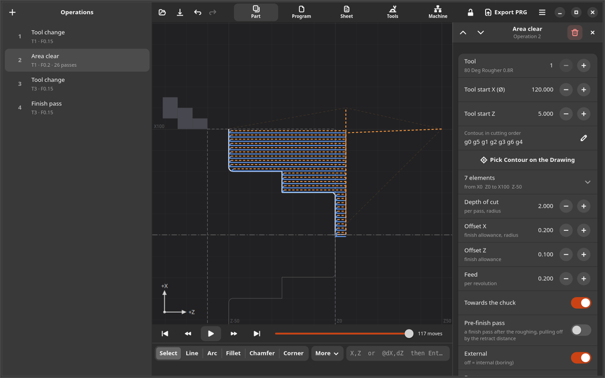
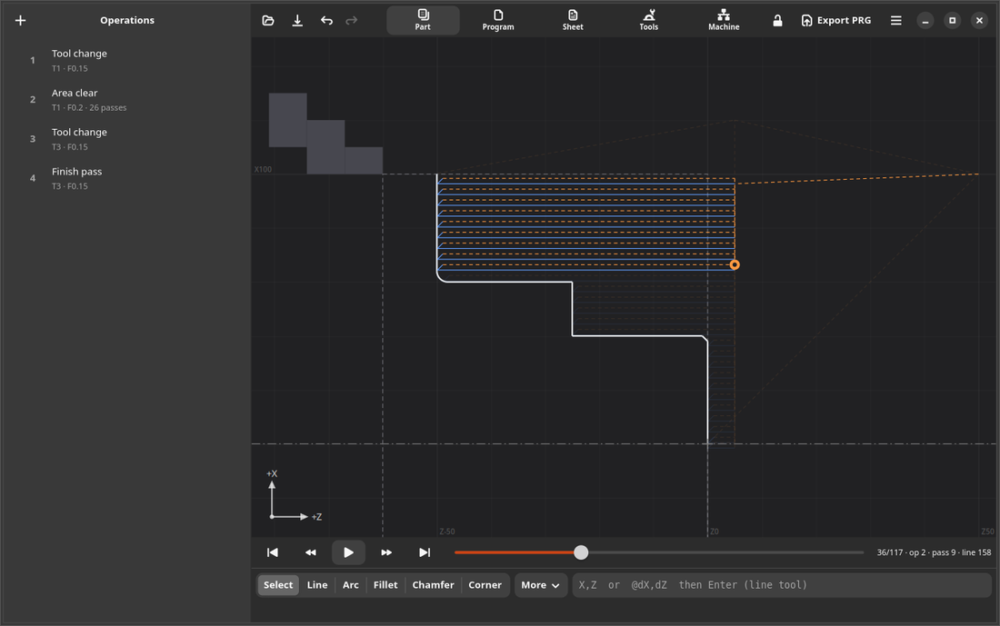
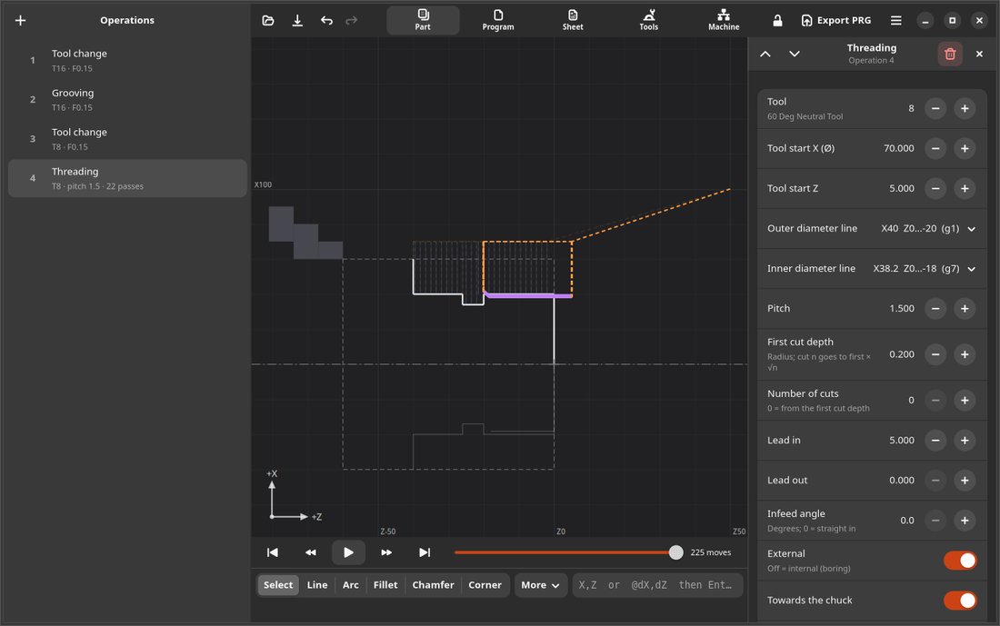
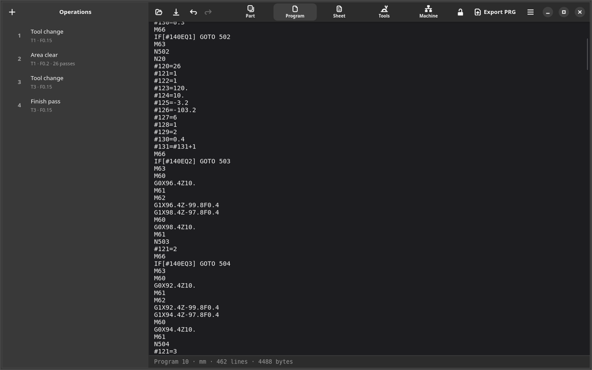
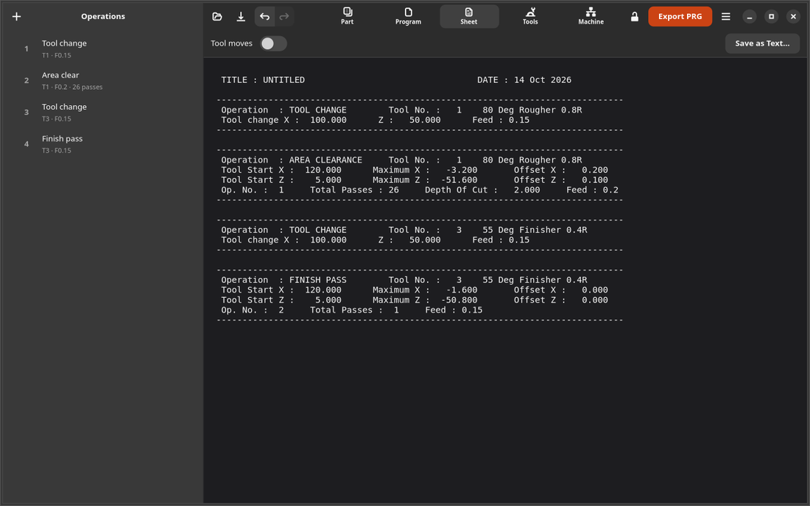
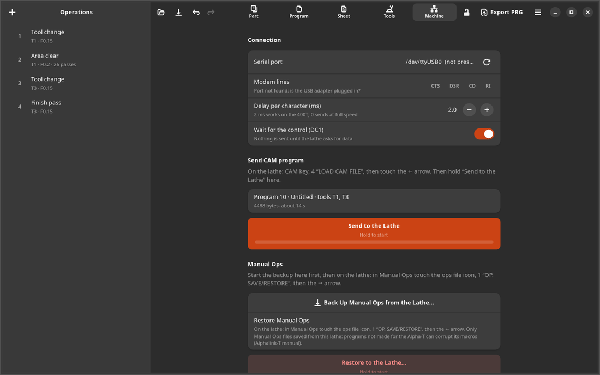
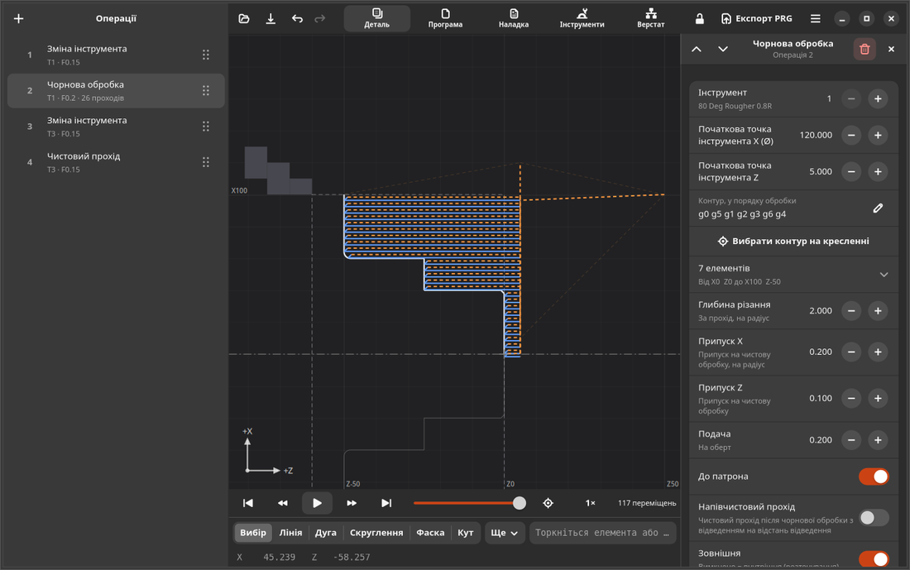

# alphalink

Reverse-engineering notes and tools for the Superdraft **ALPHACAM / AlphaLink** lathe CAD/CAM suites
(DOS ALPHACAM V1.81, DOS ALPHA-T "AlphaLink V1.2", Windows SerioAlpha / AlphaLink for Windows) and their RS232
link to Harrison Alpha lathes. Target: Harrison **Alpha 400T** (FANUC Power Mate 0).

This repo holds only our own work (notes, scripts, structured data, generated samples). The vendor software,
manuals and photos are not included; `docs/VENDOR_FILES_SHA256.txt` identifies the exact files used. Where the
original downloads can still be found is listed in `docs/SOURCES.md`.

**Start here:** `docs/ALPHA-T_STATUS.md` (current state, safe order on the machine) and `app/` (AlphaLink CAM, the
GNOME replacement for ALPHA-T; design and status in `app/DESIGN.md`).

## AlphaLink CAM

A GNOME app (Rust, GTK 4, libadwaita; `rust/`) that replaces the DOS ALPHA-T on a PC or a Surface next to the lathe: draw
the part, add the operations, check them in the simulation, and send the program over RS232. It writes the same
.PRG program and .SD1 listing as ALPHA-T, byte for byte, for the ALPHA-T samples in `samples/alphat_v12` and
`samples/alphat_v12_inch` (67 metric and 11 inch sets). The exceptions (reasons in `docs/RE_NOTES.md`, Progress 36-39; checked by
`rust/alphacam/tests/post.rs`): two face clears and two inch samples within 0.001, and the AWAY, chuck-end-pick and
GROOVE_back samples, where ALPHA-T's own output is unusable.
So the lathe's Harrison macros treat the app's programs as ALPHA-T programs.



* **Drawing**: lines and arcs by typed X,Z / @dX,dZ or by taps with snapping and a grid; fillets, chamfers (any
  angle), corners; ALPHA-T's construction commands under **More** (circle, tangents, parallel line, split arc,
  blend arc, Mirror Image); Edit Element to retype end points, or drag a point's handle; standard threads (ISO
  metric, UNC, UNF) with the minor line, a relief groove and the threading operation in one step; chamfer or round
  every outside corner at once; ALPHA-T's one-letter keys (X, D, F, K, L, A, ...), also with the Ukrainian keyboard
  layout; right click (or Shift+F10) and long press open the element menu; DXF import.
* **Operations** (every ALPHA-T option that gives a usable program): area clear (internal, face direction, follow
  contour, retract distance, pre-finish), finish pass (internal, face), face clear, grooving (radial, internal, face
  grooving, pecking, finish mode, datum, Z shift and repeats), threading (pitch, cuts, lead in/out, infeed angle,
  spring passes), drilling (peck, dwell, full retract, retract distance), tool change, dwell, move / rapid.
  ALPHA-T's AWAY programs are unsafe on real parts, so the app refuses AWAY and says why. New operations take the
  outer profile (grooves and threads their own lines) and bring their own tool change; operations can be duplicated
  and reordered by dragging. Job templates add a whole sequence (shaft, bush, groove and thread, or your own) with
  the contours picked from the drawing.
* **Checking**: pass-by-pass simulation linked to the program lines (speed, jump to an operation or a tapped
  toolpath), the program exactly as sent (search, go to N10), ALPHA-T's setup sheet with restart numbers, tool
  warnings, and a safety check before export (gouges, rapids through the part, chuck jaws, tailstock, dives steeper
  than the tool clears, and ALPHA-T's own "Invalid tip angle" rule); warnings never block a deliberate program. A cycle time estimate (constant surface speed,
  per tool) and a printable PDF setup sheet with the part, the tools in loading order and notes for the operator.
* **Files**: parts as .alcam; opens ALPHA-T drawings (.SDG, operations rebuilt from the .SD1) and DXF; exports
  .PRG + .SD1, optionally in other units than the drawing; saves ALPHA-T drawings (.SDG) so DOS ALPHA-T can open
  them. DXF import turns and places the drawing (front face, axis, Z0) and reads circles; Turn Part Around makes the
  second setup for the other end.
* **Machine**: sending with the control's XON handshake, Manual Ops backup (the 400T's DC2 ... DC4 output, waiting
  through its pauses, partial data always kept) and restore, loopback cable test; the app never starts a cycle.
* **Touch, mouse, keyboard and pen**: every feature from each (`app/TOUCH.md`, `app/POINTER_KEYBOARD.md`):
  thumb-sized controls, a number pad on every number field, touch lock while coolant runs, ALPHA-T's keys plus page,
  operation and simulation keys. English and Ukrainian, in-app help (F1), and a Training and a Reference Manual (PDF,
  both languages) from the help.

| | |
|---|---|
|  |  |
|  |  |
|  |  |

Build and install the Flatpak:
```
flatpak-builder --user --install-deps-from=flathub --jobs=8 --install --force-clean build-dir rust/build-aux/io.github._0wn3r.AlphaLinkCAM.json
flatpak run io.github._0wn3r.AlphaLinkCAM
```
Tests: `cd rust && cargo test --workspace --exclude alphacam-gtk` (the core against the ALPHA-T samples and the
fixtures the retired Python app exported). The Flatpak also has the `alphacam` command line:
`flatpak run --command=alphacam io.github._0wn3r.AlphaLinkCAM --help`.
End-to-end UI tests on the installed Flatpak (real keyboard, mouse and touch through libei, at Surface Pro 7 sizes,
read through the app's test bus): `cd app && ALPHALINK_E2E_BRANCH=master python3 -m tests.e2e.run`, see
[app/tests/e2e/README.md](app/tests/e2e/README.md); GitHub runs them on every push.

[](https://github.com/0wn3r/alphalink/actions/workflows/rust.yml)
GitHub Actions builds the Flatpak on every push. The Rust workflow's run page offers the app's bundle
(`AlphaLinkCAM.flatpak`) for download; install it with `flatpak install --user AlphaLinkCAM.flatpak`. About shows
the commit the bundle was built from.

## Layout
| path | content |
|---|---|
| `rust/` | AlphaLink CAM, the app: core (`alphacam`), command line (`alphacam-cli`), GTK app (`alphacam-gtk`), Flatpak manifest (`build-aux/`) |
| `app/` | the app's design (`DESIGN.md`, `TOUCH.md`, `POINTER_KEYBOARD.md`), interface files (`alphacam_gtk/ui/`), user help (`alphacam_gtk/help/`), manuals (PDF, `alphacam_gtk/manuals/`), translations (`po/`), desktop file and icon (`data/`), example parts (`examples/`), end-to-end tests (`tests/e2e/`) |
| `docs/HANDOVER.md` | short handover: state, rules, build and test |
| `docs/ALPHA-T_STATUS.md` | ALPHA-T status, safe order on the machine, open items |
| `docs/RE_NOTES.md` | full lab notebook (protocols, file formats, Progress 1-46) |
| `docs/DESIGN_REVIEW.md`, `INPUT_PARITY.md` | reviews of the app's interface and of touch / mouse / keyboard / pen coverage |
| `docs/SOURCES.md`, `VENDOR_FILES_SHA256.txt` | where the original vendor downloads are, and the exact files used |
| `docs/screenshots/` | README screenshots |
| `data/` | structured facts: `line_settings.json`, `cable.json`, `program_formats.json`, `atoolib_v181_tools.csv` |
| `samples/` | output of the vendor software for our test drawings: `alphat_v12/` (every ALPHA-T operation and option, .SDG/.SD1/.PRG, menu values in its README), `alphat_v12_inch/`, `alphat_units/`, `atools/` and `aprint/` (ALPHA-T tool library and printouts), `alphacam_v181/` (old DOS ALPHACAM) |
| `tools/build_ui.py`, `update_translations.py` | the app's Blueprint compiler run and translation update |
| `tools/alphalink.py`, `serial_diag.py` | PC <-> lathe transfer (send-alink, send-load, recv-save, send-alphat, recv-alphat); adapter loopback, modem lines, listen at 7E2 |
| `tools/sdg_dump.py`, `sdl_dump.py`, `dxf2sdl.py` | drawing file decoders / DXF converter |
| `tools/acsession.sh`, `atsession.sh`, `aprint_run.sh`, `dbxrun.sh`, `ac_scripts/`, `mk_at_*.py`, `xkeys.c`, `KEYS.COM` | headless DOSBox-X + Xvfb automation of the DOS programs (how the ALPHA-T samples are made) |
| `tools/cnc_capture.py`, `run_capture.sh`, `run_alink_dosbox.sh`, `test_*.py/sh`, `*.conf` | emulator wire capture / flow-control and loopback tests |
| `tools/unexepack.py`, `patch_consts.py`, `patch_metric600.py`, `patch254.sh`, `postflip.sh`, `set_units.py` | binary helpers and ALPHACAM V1.81 patch experiments |
| `vendor-config/serioalpha/` | SerioAlpha port configuration records (small data files, decoded in RE_NOTES Progress 21) |
| `evidence/rea/` | REA (Ghidra) evidence bundles for ALINK / AMANOPS |

## Quick use
The app: install the Flatpak (above) and use its Machine page to send programs and back up Manual Ops. Its command
line: `flatpak run --command=alphacam io.github._0wn3r.AlphaLinkCAM post PART.alcam -o P.PRG`.

The stand-alone serial tools (Python 3 with pyserial):
```
python3 tools/serial_diag.py /dev/ttyUSB0 loop          # bridge DB9 pins 2-3 first
python3 tools/alphalink.py -v recv-alphat /dev/ttyUSB0 backup.MOP      # lathe: Manual Ops ops-file icon -> 1 OP. SAVE/RESTORE -> arrow →
python3 tools/alphalink.py -v --char-delay 2 send-alphat /dev/ttyUSB0 PROG.PRG  # lathe: CAM -> 4 LOAD CAM FILE -> arrow ←
```
Only send programs generated by ALPHA-T or AlphaLink CAM to an Alpha-T control (see the macro warning in ALPHA-T_STATUS.md).
